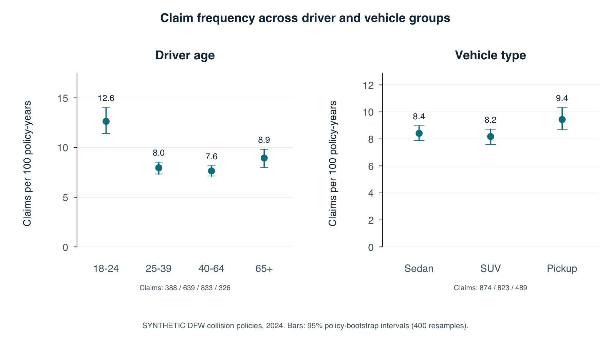

# DFW auto claims analysis with SQL and R

Compare claim frequency, average paid claim size, and annual expected claim cost across driver and vehicle groups. The pipeline builds and validates the descriptive analysis first, then adds a simple regression model.

**Insurance records and results are SYNTHETIC.** They demonstrate an actuarial workflow. Public data contains actual 2024 TxDOT crash counts for the 12-county DFW planning area. No actual insurance claims, policy exposure, or driver/vehicle insurance experience was available. Simulation assumptions are deliberately visible and are not calibrated DFW risk estimates.

## Read the results

- [Full analysis and limitations](reports/analysis.md)
- [Standalone HTML report](reports/report.html) (download and open locally)
- [Source provenance](data/public/source_manifest.json)
- [SQL group results](reports/tables/group_summary.csv)
- [Regression evaluation](reports/tables/model_metrics.csv)
- [Data dictionary and simulation assumptions](data/README.md)



## Questions answered

1. How do positive paid claim rates differ by driver age, vehicle type, and vehicle age?
2. Which groups have larger average paid claims?
3. What annual cost follows from frequency multiplied by severity, and how does it differ from cost per observed policy term?
4. Does a simple Poisson frequency / Gamma severity model improve on an overall training-set baseline in a synthetic holdout?

There are four figures: claim frequency, average claim size, annual expected cost by driver/vehicle combination, and held-out regression calibration. Bootstrap intervals are included for the first two; all grouped interval values are exported.

## DFW scope

Collin, Dallas, Denton, Ellis, Hood, Hunt, Johnson, Kaufman, Parker, Rockwall, Tarrant, Wise. This is [NCTCOG's 12-county Metropolitan Planning Area](https://www.nctcog.org/getmedia/650c132b-7fd9-478a-bafd-2d995ccc0c8c/1-0-Introduction.pdf), not every possible metro definition.

Only those counties' observations are retained from [TxDOT's 2024 county crash table](https://www.txdot.gov/content/dam/docs/division/trf/crash-records/2024/13.pdf). The source was processed as of April 9, 2025; retrieved October 15, 2026. This is a fixed historical snapshot, not a claim to exhaust all public DFW datasets or use the latest year. Public counts determine county sample weights only.

## Run the entire project

Requires **R >= 4.4**, **Python >= 3.10**, and no third-party R or Python packages. The optional source refresh requires `pdfplumber`; it is not needed to reproduce the committed results.

```bash
python3 scripts/run.py
```

If Rscript is not on PATH, set `RSCRIPT` to its executable path. Run commands from the repository root. The runner changes to the root itself, uses fixed seeds, and rebuilds generated outputs.

```text
R/01_simulate.R
  -> labeled synthetic policy and claim CSVs
sql/01_schema.sql + sql/02_policy_fact.sql + sql/03_group_summary.sql
  -> SQLite constraints, one-row-per-policy fact, grouped ratio-of-total results
tests/test_analysis.py
  -> geography, referential integrity, zero claims, multiple claims, denominators
R/02_analyze.R
  -> intervals, four charts, regression, holdout metrics, written findings
scripts/render_report.py
  -> standalone HTML report with embedded figures
```

The generated SQLite database and fitted R model objects live in ignored `work/`. Small result tables and figures are committed so the project is readable without running anything. Data generation was verified with R 4.5.3. Other R versions/platforms can produce small numeric or rendering differences; see [session information](reports/sessionInfo.txt).

## SQL demonstration

`02_policy_fact.sql` aggregates claims before left-joining policies. This prevents exposure inflation from multiple claims and retains zero-claim policies. `03_group_summary.sql` uses a CTE, `UNION ALL`, `CASE`, `GROUP BY`, and guarded division. Python's standard-library SQLite engine executes the actual SQL files.

```sql
SELECT driver_age_group,
       SUM(claim_count) * 1.0 / SUM(exposure_years) AS frequency,
       SUM(total_paid_usd) / NULLIF(SUM(claim_count), 0) AS severity,
       SUM(total_paid_usd) / SUM(exposure_years) AS annual_expected_cost
FROM policy_fact
GROUP BY driver_age_group;
```

## R regression demonstration

The policy split is fixed at 75% training / 25% testing. Every claim inherits its policy's split. Training outcomes alone determine model coefficients and the baseline. There is no test-set tuning.

```r
freq <- glm(claim_count ~ driver_age_group + vehicle_type + vehicle_age_group +
              offset(log(exposure_years)), family = poisson(link = "log"), data = train)
sev <- glm(paid_amount_usd ~ driver_age_group + vehicle_type + vehicle_age_group,
           family = Gamma(link = "log"), data = sev_data)
```

The frequency prediction is a count for the actual exposure. Multiplying by predicted severity yields expected term cost; dividing by exposure gives annual cost. The report compares count deviance, term-cost MAE/RMSE, aggregate actual/expected, and calibration against an overall training-set baseline. See [R's GLM documentation](https://stat.ethz.ch/R-manual/R-patched/library/stats/html/glm.html) and [GLM families](https://stat.ethz.ch/R-manual/R-patched/library/stats/html/family.html).

## Validation

```bash
python3 -m unittest discover -s tests -v
```

Tests include a constructed half-year policy with two claims and a full-year policy with no claims. This catches the common error of duplicating exposure during a claim join. The pipeline also checks loss/count reconciliation, group rollups, out-of-region values, invalid exposure, orphan claims, converged fits, and policy separation between training and test sets. GitHub Actions reruns the complete workflow.

## Interpretation limits

Synthetic insurance results describe the simulator. They cannot support conclusions about actual DFW drivers, insurance pricing, or real out-of-sample accuracy. Public crash records have no insured exposure or paid losses. The demonstration assumes settled positive paid collision claims, simple independent Poisson/Gamma processes, stable terms, and proportional exposure. It omits development, inflation, weather dependence, coverage differences, and expenses. [The report explains these limits in detail](reports/analysis.md#4-limitations).

## Repository layout

```text
data/public/       DFW-only observed county counts and source manifest
data/synthetic/    Clearly labeled demonstration policies and paid claims
sql/              Schema, safe claim join, group calculations
R/                Simulation, analysis, plots, and regression
scripts/          SQL execution, pipeline, HTML rendering, optional source refresh
tests/            Denominator and integrity checks
reports/          Findings, four figures, model outputs, and result CSVs
```

Code is MIT licensed. Public source data remains subject to the source's terms and attribution; see `data/README.md`.

