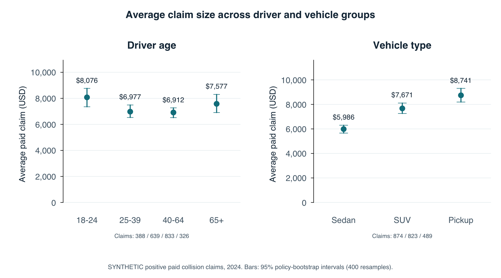
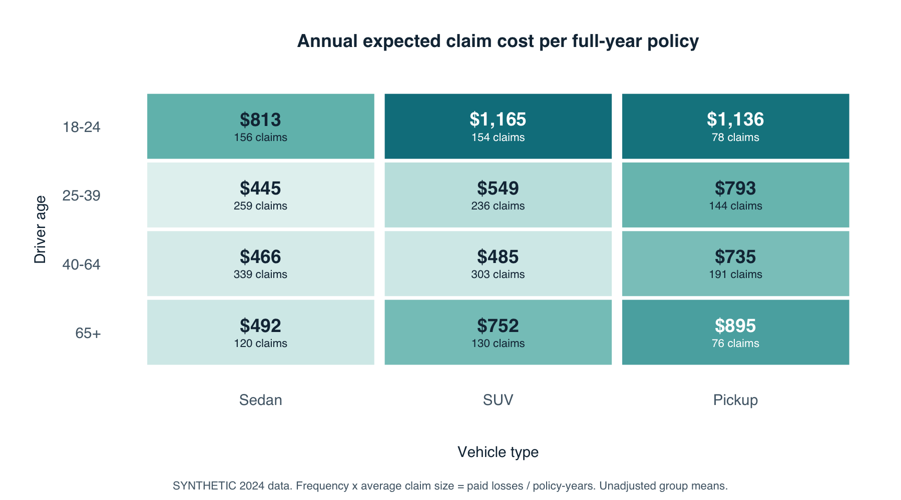
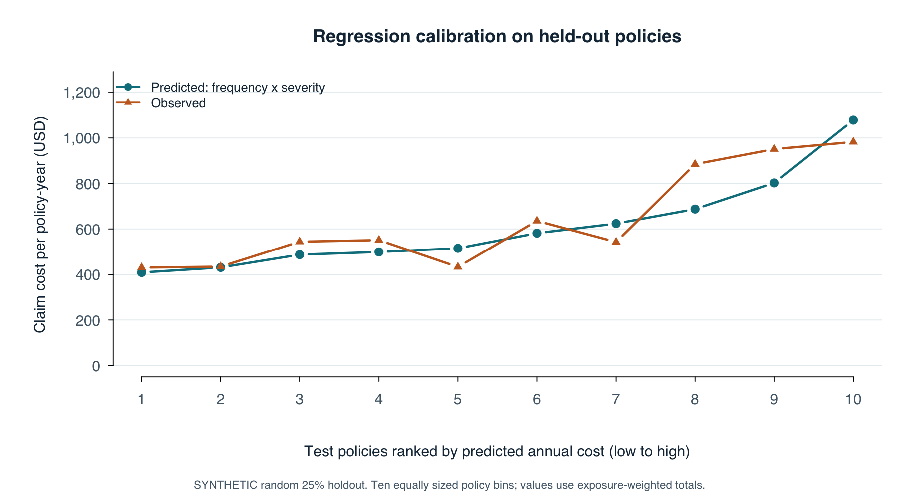

# DFW auto claims: frequency, severity, and expected cost

**All policy, claim, and regression results below are SYNTHETIC educational examples.** Actual public data is restricted to the DFW county crash table. No real insurer data was supplied.

## 1. Local public data and scope

DFW is defined as NCTCOG's 12-county Metropolitan Planning Area: Collin, Dallas, Denton, Ellis, Hood, Hunt, Johnson, Kaufman, Parker, Rockwall, Tarrant, and Wise. This differs from other metro-area definitions.

The retained TxDOT 2024 extract contains **119,882 reported crashes**. The source was processed as of April 9, 2025. Every retained public observation is within these 12 counties.

| County | Reported_crashes | Fatal_crashes |
| --- | --- | --- |
| Collin | 15,348 | 67 |
| Dallas | 46,257 | 305 |
| Denton | 12,339 | 47 |
| Ellis | 3,861 | 40 |
| Hood | 842 | 10 |
| Hunt | 1,766 | 21 |
| Johnson | 2,734 | 18 |
| Kaufman | 2,586 | 21 |
| Parker | 2,587 | 30 |
| Rockwall | 2,362 | 5 |
| Tarrant | 28,074 | 189 |
| Wise | 1,126 | 26 |

Source: [TxDOT 2024 county crash table](https://www.txdot.gov/content/dam/docs/division/trf/crash-records/2024/13.pdf). Scope: [NCTCOG Mobility 2050 introduction](https://www.nctcog.org/getmedia/650c132b-7fd9-478a-bafd-2d995ccc0c8c/1-0-Introduction.pdf).

Crash counts supply county sampling weights for the demonstration. They do not calibrate insurance frequency, severity, or exposure. Raw count differences reflect traffic volume and reporting as well as risk. No outside-region insurance sample is used.

## 2. Definitions and SQL analysis

One policy term covers one vehicle and one rated driver in the simulation. A policy may have multiple positive paid collision claims. Earned exposure ranges from 0.25 to 1 policy-year. All claims are assumed fully settled at the same valuation basis.

- Claim frequency = number of positive paid claims / earned policy-years.
- Average claim size (severity) = total paid claim amount / number of positive paid claims.
- Estimated annual expected cost per full-year policy (pure premium) = frequency x severity = total paid / policy-years.
- Observed average cost per policy term = total paid / number of policy terms. This reflects the actual mix of term lengths.

Frequency is a count rate, not the probability of at least one claim. Claims with no payment are absent by design. SQL aggregates claims first and left-joins to policies so zero-claim policies remain in the denominator. Every group uses ratios of totals.

The synthetic book contains **30,000 policy terms**, **25,643.00 policy-years**, and **2,186 paid claims**. Total simulated losses are **$15,819,648**.

Overall: **8.52 claims per 100 policy-years**, **$7,237 per paid claim**, and **$617 expected annual claim cost**. Cost per observed policy term is **$527**. These are simulated results, not DFW market estimates.

### Driver groups (synthetic)

| Group | Policy-years | Claims | Claims / 100 policy-years | Average paid claim | Annual expected cost |
| --- | --- | --- | --- | --- | --- |
| 18-24 | 3,071.0 | 388 | 12.63 | $8,076 | $1,020 |
| 25-39 | 8,029.0 | 639 | 7.96 | $6,977 | $555 |
| 40-64 | 10,897.5 | 833 | 7.64 | $6,912 | $528 |
| 65+ | 3,645.5 | 326 | 8.94 | $7,577 | $678 |

### Vehicle types (synthetic)

| Group | Policy-years | Claims | Claims / 100 policy-years | Average paid claim | Annual expected cost |
| --- | --- | --- | --- | --- | --- |
| Sedan | 10,388.0 | 874 | 8.41 | $5,986 | $504 |
| SUV | 10,071.0 | 823 | 8.17 | $7,671 | $627 |
| Pickup | 5,184.0 | 489 | 9.43 | $8,741 | $825 |

### Vehicle age groups (synthetic)

| Group | Policy-years | Claims | Claims / 100 policy-years | Average paid claim | Annual expected cost |
| --- | --- | --- | --- | --- | --- |
| 0-4 | 9,089.8 | 725 | 7.98 | $8,769 | $699 |
| 5-9 | 8,903.8 | 726 | 8.15 | $7,107 | $580 |
| 10+ | 7,649.5 | 735 | 9.61 | $5,854 | $562 |

In the synthetic book, drivers aged 18-24 have 1.65 times the claim frequency of ages 40-64. Pickups have 1.46 times sedan severity. These patterns largely reflect the assumptions coded in the simulator; they are not discoveries about DFW drivers.






The frequency and severity figures include 95% percentile intervals from 400 policy-level bootstrap resamples. Resampling policies retains multiple claims together. Cross-group intervals are descriptive and have no multiple-comparison adjustment. Complete interval values, including annual-cost intervals, are in reports/tables/bootstrap_intervals.csv.

## 3. Regression added after the basic analysis

The runner executes the SQL summaries and denominator/join tests before running this model. An exact 75%/25% random policy split keeps all claims from a policy together. Model fitting uses only training outcomes; no model is selected or tuned on test outcomes. Full-book descriptive tables include both partitions.

The simple two-part model uses driver age group, vehicle type, and vehicle age group:

```text
Claim count ~ Poisson(exposure_years x exp(X beta))
log(E[claim_count]) = X beta + log(exposure_years)
Paid claim amount | positive paid claim ~ Gamma(mean = exp(X gamma), log link)
Expected term cost = predicted claim count x predicted mean claim amount
Expected annual cost = expected term cost / exposure_years
```

The exposure offset fixes proportionality to time insured. Severity is fitted at individual-claim level. Model assumptions include stable paid-claim definitions, conditionally Poisson counts, positive Gamma costs, multiplicative group effects, and no residual frequency/severity dependence after conditioning. No county effect is imposed or estimated from public crash counts.

Reference categories: driver 40-64, Sedan, vehicle age 5-9. Exponentiated coefficients are conditional multiplicative factors; the intercept is the corresponding baseline rate or average cost. Coefficients and approximate model-based Wald intervals are exported. Their intervals do not account for real-world misspecification or clustering beyond the simulation assumptions.

Training has 22,500 policies and 1,641 claims. Testing has 7,500 policies. Training Poisson Pearson dispersion is 1.005; values well above 1 would motivate a negative-binomial or quasi-Poisson assessment with real data.

| Model | Mean count deviance | Term cost MAE | Term cost RMSE | Predicted annual cost | Actual / expected |
| --- | --- | --- | --- | --- | --- |
| Training overall baseline | 0.3812 | $986 | $2,685 | $609 | 1.051 |
| Poisson frequency x Gamma severity | 0.3791 | $986 | $2,679 | $613 | 1.044 |

Held-out observed annual cost is **$640**. Compare both models against that same outcome. Count deviance evaluates frequency; MAE and RMSE evaluate realized term costs, including zeros. Calibration compares aggregate observed and predicted losses using the same exposure denominator. Lower deviance, MAE, and RMSE are preferable, but an individual metric can favor the baseline because most policy outcomes are zero.

Relative to the baseline, the regression reduces mean count deviance by 0.55% and term-cost RMSE by 0.22%. This is a small improvement in one synthetic holdout; no statistical significance or real-world predictive improvement is established.



The deciles are formed from predicted annual cost only. Ties are broken by policy ID, so adjacent bins can share the same predicted risk. Lines show aggregate rates, not individual prediction accuracy. The random holdout tests recovery of a known simulator and does not establish performance on future DFW insurance claims.

## 4. Limitations

1. Insurance data is synthetic. Driver/vehicle mixes, exposure, count rates, severity levels, and group effects are teaching assumptions. Geographic labels do not turn simulated losses into observed DFW evidence.
2. Public crashes lack earned insured exposure, paid losses, coverage, policy limits, and deductibles. A crash can create zero, one, or multiple insurance claims; hail, theft, and other non-crash losses are outside this collision-only example. Crash location also differs from the county where a policy is garaged.
3. The extract includes every county in the chosen DFW boundary for one source/year. It does not include every local dataset or every crash, and it is not the latest available reporting year. Police-reported crashes are subject to reporting and processing rules.
4. The synthetic county mix follows crash-count shares, not population, registered vehicles, insured policies, or miles driven. Driver age and vehicle type are sampled independently; no realistic joint DFW distribution is claimed.
5. Fully settled positive paid collision claims are assumed. Real paid data is affected by open claims, development, recoveries, zero-paid claims, policy changes, large losses, inflation, and limits/deductibles. No loss-development or inflation adjustment is possible here.
6. Unadjusted group comparisons are associations affected by group mix. Annualization assumes claims scale with earned time. It does not account for miles, seasonality, commuting, driver history, or selection effects.
7. The Gamma simulation has a much simpler tail than real catastrophic or mixed-coverage losses. Poisson counts omit shared weather events, heterogeneity, and dependence. Bootstrap intervals and coefficient intervals quantify assumptions within this toy book, not actual DFW uncertainty.
8. The regression omits interactions and many possible predictors. The random test split is not a time-based validation. Good recovery of simulated effects is expected and cannot justify real insurance pricing. Pure premium excludes expenses, profit, taxes, reinsurance, and risk margins.

## 5. Replacing the demo with real DFW data

Use de-identified policy-term and claim tables with a stable join key, DFW garaging county, earned exposure, dates, driver/vehicle attributes, coverage, deductibles/limits, and consistent paid or ultimate loss valuation. Include zero-claim policies and explicitly choose whether zero-paid claims count toward frequency. Validate development and inflation treatment, cluster renewals by policy/household, and reserve a later period for testing. Update the schema's SYNTHETIC-only constraints and labels intentionally before running real records; do not publish private insurer data to this repository.

